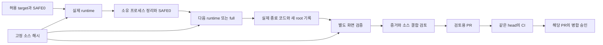

# Loading/offline 후속 검증 결과와 추가 개선 제안

상태: 검증 결과 확정 / 추가 개선안은 검토용 초안. 2026-09-06.

[Digging PR #74](https://github.com/reach0908/digging-n-ditto/pull/74)의 구현·실제 전체 검증·독립 검토·최종 커밋 CI가 완료됐다. 최종 head는 `dc95db7a61777598b9e9d2af85ee318664d23cc2`, 검증 base는 `89d34eecb7419f904f7d5ac430d36af5d6985645`다. 담당 작업이 별도 사용자 위임 범위에서08:51:12UTC 정상squash병합했다. mergeSHA는`4c8e536e4d7dfa4a0b5cb4df2a7417bb3075c34c`이며 원격MERGED/main ref와 검토dc95의전체tracked tree동일성을 확인했다. 배포와 병합 후 main CI는 담당 작업의 별도 확인 범위다.

## 확인한 결과

| 범위 | 실제 증거 |
|---|---|
| 구현 | readiness120초, 개별 요청 최대15초, 자식 명령180초; TERM5초+KILL2초 안의 실제 그룹 부재·child close 확인 |
| 실패 보존 | initial-absent·TERM·KILL의 늦은 close를 실패로 유지. cleanup 미확인 시 handle·lease 유지, reset/unlock 차단 |
| 회귀 | pure44/44, 실제 normal/forced45/45, full 안의 반복 forced45/45, 공유 lock24/24 PASS |
| 로컬 통합 | runtime11개287.27초; 4AC1040.91초 PASS; ROOT_VERIFY_PASS와 독립 matrix13routes/11wrappers/20fixtures PASS |
| 커밋 연결 | sourcef61에서 실제 실행, 소스6해시가 동일한 상태에서 actualgenerated26개만 dc95에 커밋. 앱 지문 b9d84760…/542 시작·종료 동일 |
| 독립 검토 | code/test/verifier-integrity의 소스 검토와 실제 full·cleanup·증거 결합 검토 모두 완료 |
| 원격 CI | [Verify34021446496](https://github.com/reach0908/digging-n-ditto/actions/runs/34021446496) SUCCESS, 26분09초. exactdc95, Runpnpmverify 및 실제 forced45/45 PASS |
| 자원 반환 | 08:03:31UTC exactSAFE0/readOnlytrue, 관측 소유PID2323개·기록된 모든 그룹 부재, 포트·잠금 해제, 기존 PG46809 보존 |

이전 e1a 소스의 실제 full FAIL과 모든 RED→GREEN 원문을 보존했다. 좁은 회귀·설치 상태·정적 리뷰를 전체 실행으로 대신하지 않았다. 프로세스 그룹을 벗어난 writer 격리와 종료 이후 stale-lock 정책은 이번 변경의 보장 범위가 아니다.

기존 provider 릴리스와 설치 평가는 [후속 개선 결과](2026-09-06-followup-results.md)에, native 평가의 실제 한계는 [평가 보고서](2026-09-05-native-evaluation.md)에 따로 기록돼 있다. 이번 consumer 검증으로 native 평가의 INCOMPLETE를 변경하지 않는다.

## 새로 관측한 위험 분류 문제

같은 최종 코드에서 필수 `--from-git origin/main`은 private `.loop/`까지454경로를 수집해 `DENY_AND_LOG high/full/low`를 출력했다. 게시할 실제32경로를 전수 추출해 지원되는 `--path`로 전달하면 `REQUIRE high/?/?`였다. 서로 다른 입력 범위의 결과이며 같은 입력의 비결정성은 아니다.

[classify-risk.mjs:213](/Users/jinhokim/dev/paul-loop/tools/loop-engine/bin/classify-risk.mjs:213)는 committed diff와 untracked status를 합친다. [같은 파일의 dimension completion:345](/Users/jinhokim/dev/paul-loop/tools/loop-engine/bin/classify-risk.mjs:345)은 “a matched surface ... has its unset dimensions completed to low/full/low”라고 설명한다. private report의 harness 규칙이 미정 차원을 채우지만, 게시32경로에서는 `many-files`만 일치해 불확실성이 남았다.

두 결과와 정확한 입력 집합은 원문으로 보존했고, 실제 PR에는 더 강한 REQUIRE를 그대로 표시했다. 기존 후속 PR 게시 요청과의 권한 일치를 확인했으며, 이 결과를 새 merge/deploy/bypass 권한으로 사용하지 않았다. 분류기·risk-rules·Git ignore·위험 차원 override는 수정하지 않았다.

| 우선순위 | 구체적인 편집 제안 | 행동·권한 영향 |
|---|---|---|
| 1 | classifier에 게시할 base/head 경로와 작업폴더 검사를 명시적으로 구분하는 모드를 설계한다. 미게시 source 변경은 조용히 제외하지 않고 오류 또는 별도 위험으로 표시한다. | 입력 범위 변경은 승인 요구의 적용 범위를 바꿀 수 있다. 따라서 자동 진행 범위에 영향을 주는 변경으로 검토해야 한다. 무관한 private report 생성이 같은 게시 diff의 판정을 바꾸지 않는 회귀가 필요하다. |
| 2 | `knownSurface`의 집합 전체 default 보충이 다른 미분류 경로의 불확실성을 덮지 않도록 coverage와 차원을 경로별로 검토한다. | 모르는 위험을 유지하는 방향이다. 무관한 알려진 경로 추가가 REQUIRE를 완화하지 않아야 하며, 명확한 merge/deploy/send 보호는 유지한다. |
| 3 | `--render-md`의 판정 표·사유·감사 표식과 상세 MATCHED trace를 분리하고 전체 trace의 hash/경로를 제공한다. 원문은67,402자로 PR 본문보다 컸다. | 표현만 바꾸는 제안이다. 판정값·전수 입력·원문 추적성을 유지하고 승인 규칙을 변경하지 않는다. |

## Consumer 검증 그래프 제안

AC2가 통과한 뒤 AC3의 반복 forced-stop이 실패했던 실제 사례는 실행 순서와 정리 상태도 의존 관계임을 보여준다. 소스 해시와 명령 문자열만으로 뒤의 실행을 재사용하면 이 실패를 놓칠 수 있다.

정적 검토는 동일한 바이트와 적용 범위를 확인해 재사용할 수 있다. runtime 재사용을 도입하면 실제 실행을 생략하는 조건이 생기므로 완료 기준과 자율성 범위의 변경으로 검토해야 한다. cleanup FAIL·lease 잔존·다른 target·순서 변경·낡은 artifact가 뒤 노드의 PASS를 만들지 못하는 회귀가 선행해야 한다. 현재 4AC/full 계약은 그대로 실행했다.

## 증거 보존

[원문 백업 manifest](/Users/jinhokim/dev/paul-loop/.git/consumer-audit-backups/20260906T085050Z/manifest.json)에 실제 명령·receipt·source snapshot·실패/성공 로그·독립 보고서·게시 인계와 최종 diff를 보존했다. 백업은 작업폴더의 private 증거이며 GitHub에 게시한 파일 집합과 구분한다.

추가 제안은 구현 전 검토용이다. 이 문서 작성은 provider 동작·설치·캐시·memory 설정을 바꾸지 않는다.

